  

  
  
  

 

### 안녕하세요, 한승호입니다 👋

탄소·ESG 데이터 플랫폼에서 **백엔드와 분석 화면**을 만들고 있습니다.
ERP·MES·IoT에서 들어오는 데이터를 하나의 기준으로 모으고, 그 데이터로 제품 탄소발자국(PCF)·CBAM·조직 배출량(OCF)을 계산하는 기능을 개발합니다.

- 🛠️ 주로 쓰는 것 — C# · ASP.NET Core · Dapper · SQL
- 📊 화면 — jQuery · Chart.js로 대시보드 만들기
- 🧪 요즘 공부하는 것 — 로컬 LLM(Ollama), 컴퓨터 비전(YOLO)
- 🐟 [포트폴리오](https://wnmsoso9633-gif.github.io/dev-han.github.io/)에서 <kbd>F</kbd> 키를 누르면 물고기에게 먹이를 줄 수 있어요

 

### 🧰 Tech Stack

### 📂 Projects

| 프로젝트 | 내용 | 바로 보기 |
| --- | --- | --- |
| **탄소종합솔루션 데이터 기반** | 여러 시스템의 데이터를 공통기준으로 모으고, PCF·CBAM·OCF가 같은 데이터를 함께 쓰도록 만든 플랫폼 | [data insight 데모](https://wnmsoso9633-gif.github.io/dev-han.github.io/demos/data.html) |
| **정적·동적 탄소발자국 비교 대시보드** | 저장된 산정값과 현재 데이터로 다시 계산한 값을 한 화면에서 비교 | [eco insight 데모](https://wnmsoso9633-gif.github.io/dev-han.github.io/demos/eco.html) |
| **동적 재계산 파이프라인** | 원본은 그대로 두고 계산용 테이블에 재적재·재계산·동기화를 한 번에 처리 | [cbam insight 데모](https://wnmsoso9633-gif.github.io/dev-han.github.io/demos/cbam.html) |
| **감사 · 협력사 ESG 현황** | 부적합·시정조치 추이와 협력사 ESG 진단 결과를 보는 대시보드 | [audit](https://wnmsoso9633-gif.github.io/dev-han.github.io/demos/audit.html) · [ESG](https://wnmsoso9633-gif.github.io/dev-han.github.io/demos/esg.html) |
| **멀티 DB 스키마 동기화** | 여러 DB의 스키마 차이를 비교하고 검증된 스크립트를 일괄 실행하는 도구 | — |
| **로컬 LLM 항목 매칭** | Ollama로 데이터를 밖으로 보내지 않고 항목 간 유사도를 분석 | — |
| **YOLO 객체 추적** | YOLO로 영상 속 객체를 검출하고 추적하는 실습 | [저장소](https://github.com/wnmsoso9633-gif/yolo-object-tracking) |

> 데모의 회사·프로젝트 이름과 수치는 모두 일반화한 샘플 데이터입니다.

### 🌊 About this repository

이 저장소는 포트폴리오 사이트의 소스입니다. 빌드 도구 없이 HTML · CSS · JavaScript만으로 만들었습니다.

- 배경의 심해 수조는 Canvas로 직접 그립니다. 아귀, 랜턴피시, 해파리 같은 생물이 헤엄치고, <kbd>F</kbd> 키를 누르면 먹이를 줄 수 있습니다.
- `demos/` 폴더의 대시보드 5종은 샘플 데이터로 브라우저에서 바로 동작합니다. 차트는 Chart.js를 씁니다.

### 📫 Contact

- Email — [wnmsoso9633@gmail.com](mailto:wnmsoso9633@gmail.com)
- Portfolio — [wnmsoso9633-gif.github.io/dev-han.github.io](https://wnmsoso9633-gif.github.io/dev-han.github.io/)

  

